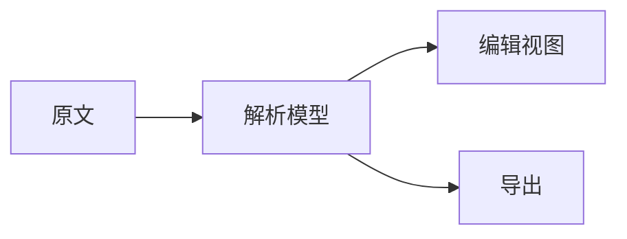
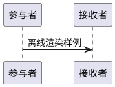

# 原生编辑与导出验收样例

本文件是 Mdown 自编验收输入，不是 Typora 导出的内容。对应行为见 [behavior-cases.json](behavior-cases.json)。本轮尚未在 Typora 或 Mdown 中执行这些动作，不能把预期结果当成观测结果。

## 1. Unicode 与输入法

中文输入：春江潮水连海平，海上明月共潮生。

组合字符：é，é；emoji：🙂、👨‍👩‍👧‍👦、🏳️‍🌈；混排：AppKit 原生编辑 123。

行内格式：**粗体中文**、*斜体*、~~删除线~~、`code **原样**`、[链接](https://example.invalid/path?q=markdown#part)、[[本地笔记]]。

## 2. 标记与选区

相邻格式：**AB**普通文字*CD*，`x y`，尾随两个空格作为 hard break。  
下一行仍属同一段。

未闭合格式：**未完成的加粗

转义字符：\*文字\*，\[非链接\]，\`不是代码\`。

引用式链接：[原生编辑][native-ref]，脚注示例[^native-note]。

[native-ref]: https://example.invalid/native "原生"
[^native-note]: 脚注内容，第二句包含中文。

## 3. 列表、缩进与合并

- 第一项
- 第二项
  - 二级项
  - 二级尾项
- [ ] 尚未完成
- [x] 已完成

1. 有序第一项
2. 有序第二项
   1. 嵌套项

> 引用第一段。
>
> - 引用内列表
> - 引用内第二项

---

## 4. 表格

| 名称 | 居中 | 数值 |
| :--- | :---: | ---: |
| 中文单元格 | **强调** | 12 |
| `a\|b` | [链接](https://example.invalid/table) | 34 |

## 5. 代码与保护范围

```swift
let message = "中文、🙂 与 **标记**"
print(message)
```

````text
外层 fence 内可包含三反引号：
```swift
let nested = true
```
````

## 6. 图表与公式



```mermaid
flowchart LR
    A[这个样例故意保持语法错误
```



行内公式：$E = mc^2$；块级公式：

$$
\int_0^1 x^2\,dx = \frac{1}{3}
$$

## 7. 图片和 HTML


<div>HTML 作为源码保护范围：**不应被输入规则无意改写**。</div>

## 8. 导出导航

[转到表格](#4-表格)，[转到公式](#6-图表与公式)。

### 三级目录节点

正文包含中文搜索词“原生编辑验收”。

##### 跳级五级目录节点

用于验证 PDF outline 保留层级与目标。
